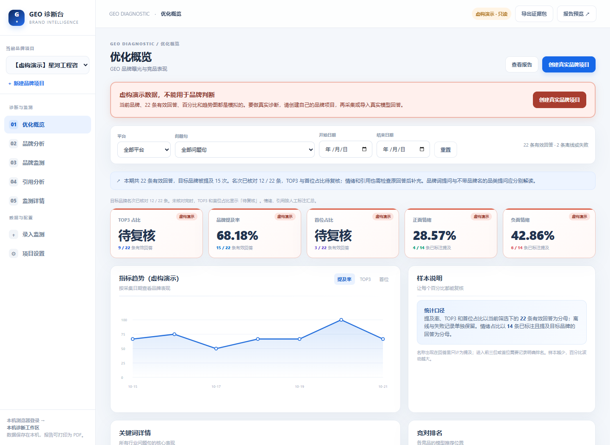

# GEO 诊断台

**解压、双击，输入品牌名，开始 GEO 检测与诊断。**

用本机浏览器查看 DeepSeek、豆包和 Kimi 如何介绍、评价和推荐你的品牌。程序自动提问、保存原回答与截图，提供品牌提及、排名、竞品和信源看板，支持导出 PDF 诊断报告。

**无需安装 Python、Node、Codex 或其它 AI 工具，也不需要配置模型 API Key。** 首次使用，在程序打开的浏览器中登录各个平台；采集后核对排名、评价和引用，就能查看对应的诊断统计。

[下载 Windows 版](https://github.com/ewanyuan/geo-brand-diagnostic/releases/latest/download/GEO-windows-x86_64-0.3.1.zip) · [下载 Linux 版](https://github.com/ewanyuan/geo-brand-diagnostic/releases/latest/download/GEO-linux-x86_64-0.3.1.tar.gz) · [全部版本](https://github.com/ewanyuan/geo-brand-diagnostic/releases) · [MIT License](LICENSE)

## 即开即用

1. **下载并完整解压。** Windows 双击「GEO诊断台.exe」；Linux 桌面运行 `geo-diagnostic` 或 `./启动GEO.sh`。保留程序旁边的 `_internal` 文件夹。
2. **输入品牌名。** 创建项目后直接进入诊断页，程序已生成起始问题并选好第一题。品类、地区、别名和竞品都可稍后补充。
3. **首次登录，开始诊断。** 点击「打开平台并登录」，在独立浏览器中自行登录；回到诊断台选择平台，点击「开始提问并保存回答」。逐个平台重复即可。
4. **查看并导出。** 原回答、提问时间、会话地址和截图自动保存。核对排名、评价与引用后查看看板；在「报告预览」打印或保存 PDF，也可下载包含原文、CSV 和截图的证据包。

需要已安装 Chrome 或 Edge；Linux 也支持系统 Chromium。使用自己的平台账号及可访问平台官网的网络。登录会话过期时按平台要求重新登录即可。



*图中为内置虚构演示数据，不是真实品牌的诊断结果。浏览器自动采集当前支持 DeepSeek、豆包、Kimi；其它平台的回答可手工录入或用 CSV 导入。*

## 能检测什么

| 诊断内容 | 可以看到什么 |
| --- | --- |
| 品牌提及 | 哪些回答提到了品牌、各平台和问题下的提及情况 |
| 推荐排名 | 经复核的首位和前三占比、竞品比较；未复核显示「待复核」 |
| 品牌评价 | 人工核对后的正面、负面和中性评价分布 |
| 引用与信源 | 回答引用了哪些网站和页面，证据能否回查 |
| 问题与平台对比 | 品牌词和品类词分开查看，按平台、问题和日期筛选 |
| 可带走的报告 | PDF、CSV、原回答及截图证据包 |

只填品牌名时，先检测 AI 对品牌的认知和评价，不猜测你的行业。补充品类并添加行业问题，可以继续检查不带品牌名时的自然推荐情况。品牌词提及率不能当作行业推荐率；统计描述本轮采集的样本，不代表搜索量或全体用户曝光。

## 系统支持

| 系统 | 可用状态 |
| --- | --- |
| Windows Intel/AMD 64 位 | 提供解压即用的 exe 包 |
| Linux x86_64 桌面 | 提供原生程序；构建基线 Debian 12 / glibc 2.36 |
| macOS / Linux ARM | 保留构建配置，尚未提供已验收的安装包 |

本版采用「自动采集 + 人工复核」流程。网页改版、账号额度、登录过期或验证可能中断采集；失败记录保留但不进入有效样本。程序不会替你完成验证码或登录验证。验证范围见 [验收说明](docs/VALIDATION.md)。

## 数据保存在本机

项目、回答、截图和专用浏览器登录资料保存在使用者自己的电脑，不需要公共采集服务器。问题会正常发送给你选择的平台。

| 系统 | 默认资料目录 |
| --- | --- |
| Windows | `%LOCALAPPDATA%/GeoBrandDiagnostic` |
| Linux | `~/.local/share/GeoBrandDiagnostic`，或 `$XDG_DATA_HOME/GeoBrandDiagnostic` |
| macOS 配置 | `~/Library/Application Support/GeoBrandDiagnostic` |

Unix 旧版已有 `~/GeoBrandDiagnostic` 时沿用旧位置。`data` 保存项目与证据，`browser-profile` 保存独立浏览器资料，不读取日常浏览器的资料。

更新前先点右下角「退出 GEO」，再替换程序文件夹，用户资料会保留。备份时复制上述资料目录并自行保管；不要把包含登录资料的目录发给别人。证据导出包不包含浏览器资料，分享截图前仍请核对账号信息。

## 开发与源码运行

普通使用者下载 Releases 即可，以下步骤仅供开发者。

```bash
python -m venv .venv
# 激活虚拟环境后：
pip install -r requirements-desktop-build.txt
python standalone.py
```

运行后会自动打开本机界面；源码运行的项目数据位于仓库 `data/` 目录，桌面包使用上表的用户目录。无账号时可先创建项目或手工录入回答。`python server.py` 用于开发，会显示只读的虚构演示项目。Windows 激活命令为 `.venv\Scripts\activate`，Linux/macOS 为 `source .venv/bin/activate`。

```bash
# 测试只使用隔离页面，不需要真实平台账号
python -m unittest discover -s tests -v

# 在对应操作系统构建原生包
python deploy/build_desktop.py --platform windows
python deploy/build_desktop.py --platform linux

# 验证本机的实际程序包
python tools/verify_desktop_package.py <程序包路径> --output <验收结果.json>
```

详细构建条件见 [平台说明](CROSS_PLATFORM.md)。API 接口采集为可选功能，可参考 `providers.example.json`；默认浏览器流程无需 API Key。使用时请自行遵守所用平台的账号规则和服务条款。

欢迎提交问题和改进，见 [参与开发](CONTRIBUTING.md)。项目源码使用 [MIT License](LICENSE)；随桌面包分发的依赖使用各自许可证，见 [第三方组件说明](THIRD_PARTY_NOTICES.md)。
